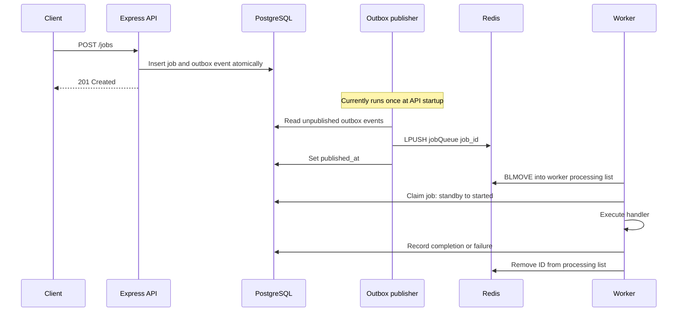
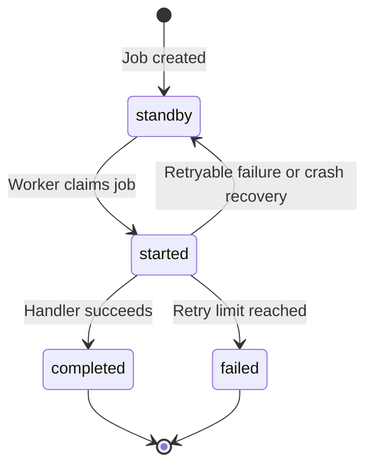

# Distributed Job System

A background job processing project built with **TypeScript**, **PostgreSQL**, and **Redis**. It explores transactional job creation, concurrent workers, and heartbeat-based crash recovery.

PostgreSQL stores job state and outbox events. Redis transports job IDs to workers through a shared queue and per-worker processing lists.

> **Current status:** The API, worker pool, and recovery service are implemented. The publisher currently runs once at API startup. Continuous publishing and retry scheduling are unfinished, so newly created jobs and retry attempts do not yet progress automatically.

## Contents

- [Overview](#overview)
- [Architecture](#architecture)
- [Reliability and limitations](#reliability-and-limitations)
- [Getting started](#getting-started)
- [Running the system](#running-the-system)
- [API](#api)
- [Job lifecycle](#job-lifecycle)
- [Data model](#data-model)
- [Testing](#testing)
- [Known limitations](#known-limitations)


## Overview

Background tasks such as sending emails should run outside the HTTP request that creates them. This project separates accepting a job from executing it and explores how to recover unfinished work when a worker stops responding.

The main components are:

- **Express API:** validates requests with Zod and writes a job and its outbox event together in PostgreSQL.
- **Outbox publisher:** reads unpublished events, pushes job IDs to Redis, and records publication in PostgreSQL.
- **Worker pool:** moves job IDs into per-worker processing lists, claims jobs in PostgreSQL, and runs their handlers.
- **Recovery service:** detects missing worker heartbeats and records unfinished jobs for publication again.

### Technology

| Area                   | Technology                          |
| ---------------------- | ----------------------------------- |
| Language               | TypeScript with ESM and strict mode |
| Runtime and API        | Node.js, Express 5                  |
| Database               | PostgreSQL 18 with `pg`             |
| Queue and coordination | Redis with `node-redis`             |
| Request validation     | Zod                                 |
| Testing                | Vitest                              |
| Development tools      | tsx, ESLint, typescript-eslint      |
| Local infrastructure   | Docker Compose                      |

## Architecture



### Worker recovery

Each worker registers its ID in `workers:registry` and refreshes a Redis heartbeat every 5 seconds. The heartbeat has a 15-second TTL.

The recovery service checks registered workers every 5 seconds. When a heartbeat is missing, it examines that worker's processing list. Jobs in `started` are returned to `standby`, and a `job_recovered` outbox event records that they need publishing again. Once the processing list is empty, the worker is removed from the registry.

Recovery currently depends on a later publisher run to return those jobs to the queue.

## Reliability and limitations

| Mechanism                  | What it provides                                                                                               | Boundary                                                                                    |
| -------------------------- | -------------------------------------------------------------------------------------------------------------- | ------------------------------------------------------------------------------------------- |
| Transactional outbox       | The job and its delivery intent are saved atomically in PostgreSQL.                                            | Delivery depends on the publisher running successfully.                                     |
| Redis `BLMOVE`             | Moving a job ID from the queue into a processing list is atomic.                                               | This does not by itself guarantee durability across Redis failures.                         |
| Conditional database claim | An `UPDATE` restricted to `job_status = 'standby'` allows only one successful claim for that state transition. | It does not guarantee that a recovered job cannot overlap with an older execution.          |
| Heartbeat recovery         | Jobs held by workers with expired heartbeats can be scheduled again.                                           | An expired heartbeat indicates suspected failure; the original worker may still be running. |
| Retry metadata             | Failure state, retry counts, and backoff timestamps can be recorded.                                           | Republishing retries and enforcing `next_retry_at` are unfinished.                          |

### Duplicate delivery and side effects

Publishing to Redis and recording `published_at` are separate operations. A publisher failure between those operations can cause a job ID to be delivered again.

The database claim helps handle duplicate deliveries, but it does not establish exactly-once execution. For example, a handler could complete an external action and then crash before recording success. Recovery could cause that action to run again. Real handlers therefore need an idempotency strategy where repeated side effects would be harmful.

### Current functional limits

- Jobs created after the startup publisher has finished remain pending until another publisher run.
- Recovered jobs also wait for another publisher run.
- Failed jobs do not yet have a complete automatic retry path.
- The email handler simulates sending an email.
- The API accepts `resize_image`, but its worker handler is not implemented.
- There is no endpoint to inspect job status yet.

## Getting started

### Prerequisites

- A recent Node.js LTS release
- npm
- Docker with Docker Compose

### 1. Clone and install

```bash
git clone https://github.com/sangT220222/distributed_job_system.git
cd distributed_job_system
npm install
```

### 2. Configure the environment

Create `.env` in the project root:

```env
DATABASE_USERNAME=postgres
DATABASE_PASSWORD=change_me
DATABASE_NAME=distributed_jobs
DATABASE_PORT=5432

REDIS_URL=redis://localhost:6380
PORT=3000
```

Use local development credentials. Keep environment files containing credentials out of version control.

### 3. Start PostgreSQL and Redis

```bash
docker compose up -d
```

PostgreSQL is exposed on host port `5432`; Redis is exposed on host port `6380`.

### 4. Apply migrations

Run the SQL migration files in filename order:

```bash
for f in src/db/migrations/*.sql; do
  docker compose exec -T db sh -c 'psql -v ON_ERROR_STOP=1 -U "$POSTGRES_USER" -d "$POSTGRES_DB"' < "$f" || break
done
```

If a migration reports an error, resolve it before starting the application. A migration runner is planned.

## Running the system

Start each component in its own terminal:

```bash
# Terminal 1: API and a single startup publisher run
npm run dev
```

```bash
# Terminal 2: worker pool
npm run worker
```

```bash
# Terminal 3: heartbeat recovery service
npm run recovery
```

Create a job:

```bash
curl -X POST http://localhost:3000/jobs \
  -H "Content-Type: application/json" \
  -d '{
    "job_type": "send_email",
    "job_data": {
      "email_address": "user@example.com",
      "email_content": "Hello from the job system"
    }
  }'
```

**After creating the job, stop and restart the API with `npm run dev`.** This triggers another publisher run so the new job can reach a worker. This manual step is required until continuous publishing is implemented.

### Scripts

| Command              | Purpose                                  |
| -------------------- | ---------------------------------------- |
| `npm run dev`        | Start the API and run the publisher once |
| `npm run worker`     | Start the worker pool                    |
| `npm run recovery`   | Start the recovery service               |
| `npm test`           | Run the test suite once                  |
| `npm run test:watch` | Run tests in watch mode                  |

## API

### `GET /`

Returns an API liveness response:

```json
{ "message": "TS API running" }
```

This response alone does not establish that the database, Redis, publisher, or workers are healthy.

### `POST /jobs`

Validates the request against the schema for its `job_type`, then persists the job and its outbox event.

| Field      | Type   | Meaning                        |
| ---------- | ------ | ------------------------------ |
| `job_type` | string | A job type accepted by the API |
| `job_data` | object | Payload for that job type      |

#### Job types

| Type           | Payload                                                | Configured `max_retries` | Handler status                      |
| -------------- | ------------------------------------------------------ | ------------------------ | ----------------------------------- |
| `send_email`   | `email_address`: email string; `email_content`: string | 3                        | Simulated email send                |
| `resize_image` | `image`: string; `new_size`: integer                   | 2                        | Not implemented; placeholder schema |

`send_notification` exists in the database enum with a configured retry limit of 2, but the API does not yet accept it.

Retry limits describe stored configuration; automatic retry scheduling is still unfinished.

#### Responses

| Status                      | Meaning                                                        |
| --------------------------- | -------------------------------------------------------------- |
| `201 Created`               | Job and outbox event persisted; execution may still be pending |
| `400 Bad Request`           | Request failed validation                                      |
| `500 Internal Server Error` | Job could not be saved                                         |

Example successful response:

```json
{
  "success": true,
  "message": "Job created",
  "data": {
    "id": "42a7d0a6-0d90-4b40-a3b1-6aba2c27c0f6",
    "job_type": "send_email",
    "job_status": "standby",
    "job_data": {
      "email_address": "user@example.com",
      "email_content": "Hello from the job system"
    },
    "created_at": "2026-09-24T20:15:31.633Z",
    "started_at": null,
    "finished_at": null,
    "retry_count": 0,
    "max_retries": 3,
    "next_retry_at": null,
    "last_error": null
  }
}
```

## Job lifecycle



`standby` means a job is available for a future claim; it does not mean its ID is already in Redis. Publishing is a separate step.

On handler failure, retry metadata includes `retry_count`, `next_retry_at`, and `last_error`. Exponential backoff is intended to space out retries, but the scheduling path does not yet republish retries or enforce their due times.

## Data model

### PostgreSQL

**`jobs`** stores the job payload and execution state.

| Column          | Type         | Purpose                                              |
| --------------- | ------------ | ---------------------------------------------------- |
| `id`            | UUID         | Primary key                                          |
| `job_type`      | enum         | `send_email`, `resize_image`, or `send_notification` |
| `job_status`    | enum         | `standby`, `started`, `completed`, or `failed`       |
| `job_data`      | JSONB        | Handler payload                                      |
| `retry_count`   | INT          | Retry counter, initially 0                           |
| `max_retries`   | INT          | Per-type retry limit                                 |
| `next_retry_at` | TIMESTAMP    | Recorded retry due time                              |
| `last_error`    | VARCHAR(255) | Last failure message                                 |
| `created_at`    | TIMESTAMP    | Creation time                                        |
| `started_at`    | TIMESTAMP    | Execution start time                                 |
| `finished_at`   | TIMESTAMP    | Execution finish time                                |

**`outbox_events`** stores delivery intent alongside job state.

| Column         | Type         | Purpose                              |
| -------------- | ------------ | ------------------------------------ |
| `id`           | UUID         | Primary key                          |
| `job_id`       | UUID         | Reference to `jobs(id)`              |
| `event_type`   | VARCHAR(255) | `job_created` or `job_recovered`     |
| `published_at` | TIMESTAMP    | `NULL` until publication is recorded |
| `created_at`   | TIMESTAMP    | Event creation time                  |

### Redis

| Key                           | Type            | Purpose                     |
| ----------------------------- | --------------- | --------------------------- |
| `jobQueue`                    | List            | Job IDs waiting for workers |
| `processing-<workerId>`       | List            | Job IDs held by a worker    |
| `workers:registry`            | Set             | Registered worker IDs       |
| `worker:<workerId>:heartbeat` | String with TTL | Worker liveness signal      |

## Testing

Vitest tests use a dedicated PostgreSQL database.

### 1. Create and migrate the test database

```bash
docker compose exec -T db sh -c 'createdb -U "$POSTGRES_USER" distributed_jobs_test'

for f in src/db/migrations/*.sql; do
  docker compose exec -T db sh -c 'psql -v ON_ERROR_STOP=1 -U "$POSTGRES_USER" -d distributed_jobs_test' < "$f" || break
done
```

### 2. Create `.env.test`

```env
DATABASE_USERNAME=postgres
DATABASE_PASSWORD=change_me
DATABASE_NAME=distributed_jobs_test
DATABASE_PORT=5432
REDIS_URL=redis://localhost:6380
```

This example uses the same Redis instance as local development. The separate PostgreSQL database does not isolate Redis state.

### 3. Run the suite

```bash
npm test
```

The test setup requires `NODE_ENV=test`, and an environment test checks that the database connection points to `distributed_jobs_test`.

## Known limitation

- **Duplicate side effects are possible.** A worker could perform an
  action, then crash before recording as Complete.
  Recovery could run that action again. Handlers need an idempotency
  strategy to prevent harmful duplicates.

- **Heartbeat is an unreliable mechanism to detect a completely failed worker.**

- **Publishing jobs can produce duplicate queue entries.** If the publisher
  pushes a job ID to Redis but crashes before marking the outbox event as
  published, a later publisher run can enqueue that ID again.

- **Publishing can produce duplicate queue entries.** If the publisher
  pushes a job ID to Redis but crashes before marking the outbox event as
  published, a later publisher run can enqueue that ID again.
